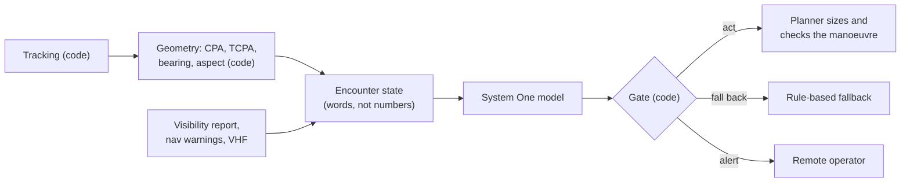

# System One for Marine Autonomy

A **System One model** takes some content plus typed questions, and returns typed answers with probabilities instead of generated text. Many hosted and open-weight models now share one request format, `POST /v1/systemone`. This tutorial uses that format and doesn't depend on any one model.

**Case study:** an autonomous vessel meets other ships. Code computes the geometry; the model answers narrow questions about the encounter; code decides whether to act on the answers. The model is a fast decision component, **not the navigator**.

## Contents

0. [What is a System One model?](00-introduction.md): facts and history
1. [System One vs LLMs](01-system-one-vs-llms.md): how the responses differ
2. [The request format](02-request-format.md): state, questions, answers
3. [Building a request step by step](03-building-a-request.md): from one yes/no question to a full encounter request
4. [Encoding state](04-encoding-state.md): the geometry as formulas, turned into words
5. [Writing clear requests](05-writing-clear-requests.md): before-and-after rewrites
6. [Using the answers](06-using-the-answers.md): gating, scoring, and a worked encounter
7. [Limitations and safety](07-limitations.md)
8. [Building the same request for an LLM](08-building-an-llm-request.md): page 3 again, with a chat LLM

All model outputs shown are **illustrative**. All thresholds are placeholders.
